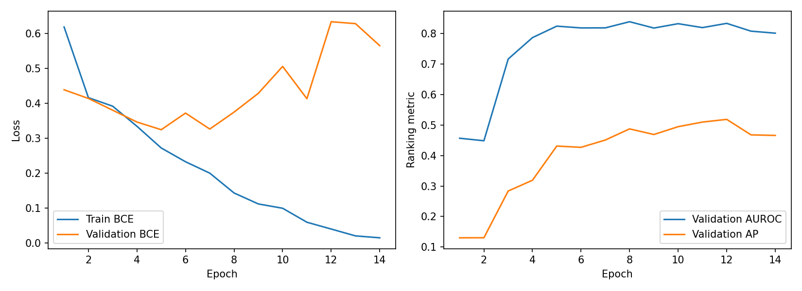
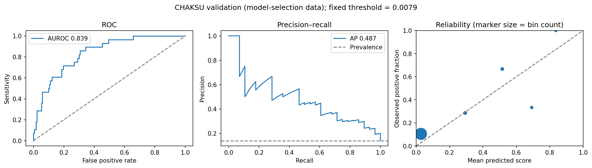

# Image-only CNN baseline for glaucoma prescreening

Team: Indira Duisembayeva, Aman Khan, and Yomna Elnikety.

This is Baseline 2 for the anatomy-informed glaucoma prescreening capstone: an ImageNet-pretrained ResNet-18 predicts glaucoma-suspicious appearance from full colour fundus photographs. Only RGB images enter the model; masks, anatomical measurements, expert votes, and camera metadata are not model inputs. This is a research baseline, not a clinically validated diagnostic system.

## Current status

Training, validation, and held-out evaluation completed successfully. Validation results below are model-selection results; the separately labelled CHAKSU and PAPILA test results used the existing epoch-8 checkpoint and unchanged validation-selected threshold, without retraining.

- Run: `20261006T074808Z_resnet18_6051f432`
- Slurm job: `219631`
- Evaluation Slurm job: `219927`; completion confirmed for both test sets.
- Selected checkpoint: epoch 8; early stopping occurred at epoch 14.
- Hardware: NVIDIA RTX 5000 Ada Generation; Python 3.12.3; PyTorch 2.9.1+cu126; torchvision 0.24.1+cu126.

## Repository contents

```text
baseline_cnn/
  README.md
  03_image_only_cnn_baseline.ipynb
  baseline_core.py
  requirements.txt
  test_baseline.py
  evaluate_saved_baseline.py
  results/
    config.json
    environment.json
    history.csv
    validation_metrics.csv
    validation_camera_metrics.csv
    learning_curves.png
    validation_curves.png
    effective_split_counts.csv
    frozen_protocol.json
    final_evaluation/  # aggregate test metrics, confidence intervals, curves and completion record
```

The notebook embeds its helpers and is self-contained. `baseline_core.py` provides the corresponding helpers for testing. The published notebook has no saved outputs. Dataset images, image-level predictions and split manifests, the executed notebook, and `best.pt` are retained separately in approved team storage. Aggregate results alone are not sufficient to rerun the experiment: obtain the matching prepared data and manifests from the team.

## Data requirements

Place the original complete pipeline export beside the notebook:

```text
artifacts/
  prepared_manifest.csv
  splits/
    split_summary.json
    all.csv
    train_classification.csv
    validation_classification.csv
    in_domain_test_classification.csv
    external_test_classification.csv
  prepared/
    chaksu/<image_id>/image_224.png
    papila/<image_id>/image_224.png
```

All manifests, summary hashes, and images must come from the same pipeline run. Do not open and resave manifests in a spreadsheet editor or substitute effective manifests for original inputs. The notebook audits the original inputs, then creates conservative effective splits. Other baselines should use the same effective assignments for fair comparison.

The audited local download contained truncated copies of `artifacts/prepared_manifest.csv` and `artifacts/splits/all.csv`. Replace those copies from the successful HPC export before rerunning. Both complete manifests contain 1,833 data records. The run's original SHA-256 values are:

```text
prepared_manifest.csv: 888c805a69297ddbf7753e06041a4636638ac39850e6009554454076b01827b9
splits/all.csv: a06d4ee94448bee53cff0ad40624a7fba64b47d4e3d6619331ef931433d06e72
```

The effective `all.csv` recorded by this run has SHA-256 `1937faba915cc4f18088943e135808b51a230dc7527dcbd78d46db0679a5a571`.

### Effective classification splits

| Split | Dataset | Images | Negative | Positive |
|---|---|---:|---:|---:|
| Training | CHAKSU | 808 | 699 | 109 |
| Validation | CHAKSU | 200 | 172 | 28 |
| Held-out in-domain test | CHAKSU | 335 | 284 | 51 |
| External test | PAPILA | 420 | 333 | 87 |

CHAKSU positives are expert-majority **GLAUCOMA SUSPECT** labels, not confirmed clinical diagnoses. PAPILA uses its binary clinical labels and excludes 68 suspect images from binary classification. This difference in label definitions limits cross-dataset interpretation.

The conservative split procedure quarantined two possible cross-release Bosch patient matches and moved two validation images into training to keep possible within-release patient groups together. Filename-based links are precautions, not verified identities. Known groups and duplicates do not cross effective partitions, but unknown CHAKSU patient linkage means these results cannot be called strictly patient-disjoint.

## Setup and execution

Run commands from the directory containing the notebook (the repository's `baseline_cnn/` directory). Use Python 3.11–3.13. On HPC, use the lab's supported Python environment and GPU allocation policy.

```bash
python3 -m venv .venv
source .venv/bin/activate
python -m pip install --upgrade pip
```

If environment creation reports missing `ensurepip`, stop and use a lab-supported Python/module or virtualenv installation; do not proceed with a broken environment or install system packages without administrator guidance.

For the recorded Linux CUDA 12.6 stack, install the matching GPU wheels first. Confirm compatibility with your lab's driver. On macOS or CPU-only machines, skip this CUDA-specific command.

```bash
python -m pip install torch==2.9.1 torchvision==0.24.1 --index-url https://download.pytorch.org/whl/cu126
```

Then install the remaining dependencies and register a notebook kernel:

```bash
python -m pip install -r requirements.txt
python -m pip install nbconvert
python -m ipykernel install --sys-prefix --name glaucoma-cnn --display-name "Glaucoma CNN"
python -m unittest test_baseline.py
```

Download pretrained weights from an internet-enabled node before starting the compute job:

```bash
python -c "from torchvision.models import resnet18, ResNet18_Weights; resnet18(weights=ResNet18_Weights.IMAGENET1K_V1); print('Weights ready')"
```

In the notebook configuration cell, replace the existing assignments with:

```python
ARTIFACTS_DIR = Path.cwd() / 'artifacts'
DEVICE_REQUEST = 'cuda'  # GPU execution; use 'auto' for a local CPU/Mac run
```

Keep `RUN_FINAL_EVALUATION = False` in the existing final-evaluation cell. Save the notebook. For an interactive local run, select the `Glaucoma CNN` kernel. Do not run training interactively on an HPC login node.

### Slurm GPU run

The example below assumes a partition named `gpu`, one GPU, and no additional account/QoS requirement. Adapt these resource options to the lab's policy. It submits the notebook for execution on a compute node, not the login node.

```bash
mkdir -p logs executed
sbatch <<'SLURM'
#!/bin/bash
#SBATCH --job-name=glaucoma-cnn
#SBATCH --partition=gpu
#SBATCH --gres=gpu:1
#SBATCH --cpus-per-task=4
#SBATCH --mem=16G
#SBATCH --time=04:00:00
#SBATCH --output=logs/cnn_%j.out
#SBATCH --error=logs/cnn_%j.err
set -euo pipefail
cd "$SLURM_SUBMIT_DIR"
source .venv/bin/activate
export MPLBACKEND=Agg
export OMP_NUM_THREADS="$SLURM_CPUS_PER_TASK"
export CUBLAS_WORKSPACE_CONFIG=:4096:8
python -c "import torch; assert torch.cuda.is_available(), 'CUDA unavailable'; print(torch.cuda.get_device_name(0))"
python -m jupyter nbconvert \
  --to notebook --execute 03_image_only_cnn_baseline.ipynb \
  --ExecutePreprocessor.kernel_name=glaucoma-cnn \
  --ExecutePreprocessor.timeout=-1 \
  --output "cnn_executed_${SLURM_JOB_ID}.ipynb" \
  --output-dir executed
SLURM
```

Use the actual job ID returned by `sbatch` to locate logs. Outputs are saved under `cnn_baseline_runs/<run_id>/` and the completed notebook under `executed/`. Each new training execution produces a new run; it does not simply evaluate the old checkpoint.

The recorded run emitted CuBLAS nondeterminism warnings despite a fixed seed. The environment variable above addresses that warning for future runs; it was not recorded as enabled in the original run. Exact replication across devices/software is not guaranteed.

## Training protocol

- Full RGB fundus images, square-letterboxed to 224 × 224; ImageNet normalization.
- ImageNet ResNet-18 V1 initialization and a binary classification head.
- Two head-only warm-up epochs, followed by full fine-tuning with frozen BatchNorm running statistics.
- Training-only mild brightness, contrast, and saturation jitter.
- Unweighted binary cross-entropy with logits; no class weighting or oversampling.
- AdamW; head learning rate 1e-4, backbone learning rate 1e-5, weight decay 1e-4.
- Batch size 16, seed 2440, maximum 25 epochs, early-stopping patience 6.
- Select checkpoint by fine-tuning validation AUROC, breaking ties using validation BCE.
- Select the highest-specificity validation operating point attaining at least 90% sensitivity.

## Results and interpretation

### Validation and test summary with saved uncertainty intervals

Entries are point estimates (95% confidence intervals where saved). All sensitivity, specificity, and balanced-accuracy values use the frozen validation-selected threshold, 0.0078666182234883.

| Metric | CHAKSU validation | CHAKSU held-out test | PAPILA external test |
|---|---:|---:|---:|
| Images / positives | 200 / 28 | 335 / 51 | 420 / 87 |
| AUROC | 0.839 | 0.792 (0.722–0.851) | 0.736 (0.664–0.804) |
| Average precision | 0.487 | 0.408 (0.291–0.539) | 0.435 (0.313–0.564) |
| Sensitivity | 92.86% | 86.27% (75.68–95.12%) | 59.77% (47.62–71.11%) |
| Specificity | 54.65% | 55.63% (48.95–61.86%) | 75.68% (70.32–80.81%) |
| Balanced accuracy | 73.75% | 70.95% (64.68–76.35%) | 67.72% (61.47–74.07%) |
| Brier score | 0.103 | 0.123 (0.094–0.153) | 0.194 (0.144–0.245) |

Sources: [validation metrics](results/validation_metrics.csv), [CHAKSU test intervals](results/final_evaluation/in_domain_test_confidence_intervals.csv), and [PAPILA test intervals](results/final_evaluation/external_test_confidence_intervals.csv). Validation intervals were not saved and are not invented here. Validation estimates were used for model/threshold selection and are not independent test results.

The test intervals are percentile intervals from 1,000 valid grouped bootstrap resamples: 314 CHAKSU analysis groups and 210 PAPILA patient groups. They preserve known within-group dependence but cannot correct unknown CHAKSU patient linkage. They describe sampling uncertainty conditional on this checkpoint and threshold, not variability from retraining. These intervals alone are not a paired significance test of the difference between datasets or methods.

On 200 CHAKSU validation images (28 positives), the epoch-8 checkpoint achieved **AUROC 0.8389** and **average precision 0.4874**. Average precision is reported as AP, not trapezoidal PR-AUC. The positive prevalence was 0.14.

| Metric | Default threshold 0.5 | Validation-selected threshold 0.0078666 |
|---|---:|---:|
| Sensitivity | 17.86% | 92.86% |
| Specificity | 97.67% | 54.65% |
| Balanced accuracy | 57.77% | 73.75% |
| Accuracy | 86.50% | 60.00% |
| Precision | 55.56% | 25.00% |
| Negative predictive value | 87.96% | 97.92% |
| F1 | 0.2703 | 0.3939 |
| True positives / false negatives | 5 / 23 | 26 / 2 |
| True negatives / false positives | 168 / 4 | 94 / 78 |

The model learned a useful ranking signal. However, at the screening-oriented threshold, it flagged 104 images, of which 78 were negative. This demonstrates a substantial false-positive burden. The default threshold missed 23 of 28 positives; its apparently high accuracy is misleading because predicting every image negative would achieve 86% accuracy.

The threshold and checkpoint were chosen on these validation data. Their reported performance is selection-dependent, not independent evidence that the sensitivity target will hold on new data.

### Overfitting

| Epoch | Training BCE | Validation BCE | Validation AUROC |
|---|---:|---:|---:|
| 5 | 0.2722 | 0.3246 | 0.8243 |
| 8 (selected) | 0.1433 | 0.3750 | 0.8389 |
| 14 (last) | 0.0149 | 0.5654 | 0.8013 |

Training loss continued falling while validation loss worsened, showing clear late-training overfitting. Epoch 5 minimized validation BCE, while epoch 8 maximized validation AUROC. This is not a contradiction: BCE evaluates probability quality while AUROC evaluates ranking. Restoring epoch 8 followed the predefined model-selection rule and avoided reporting the final, more overfit model.



**Figure 1.** Training and validation trajectories for the recorded run. Validation BCE reaches its minimum at epoch 5 while validation AUROC peaks at epoch 8. Continued reduction in training BCE without corresponding validation improvement indicates overfitting. Checkpoint selection followed AUROC, not the final training epoch.

### Qualitative error panel (local course-report supplement)

The existing saved validation error gallery is provided locally in `private_report/qualitative_panel.png`, with a report-ready caption in `private_report/README.md`. It contains the two validation false negatives and three high-scoring false positives at the frozen threshold. This is an illustrative, error-selected panel, not a random sample or a visual estimate of error frequency.

Visible differences include field-of-view shape, illumination, colour, and image scale. These observations suggest questions for expert review; they do not prove that any feature caused a prediction. No saliency method or clinical adjudication was performed. The labels refer to CHAKSU expert-majority suspicion, not confirmed clinical diagnosis.

This image supplement is intentionally Git-ignored because it contains dataset fundus photographs, embedded image markings, and identifiers. Include it only in an authorized course submission after checking image-sharing permissions and identifiers. The public repository retains the caption/interpretation but not the patient-image panel.

### Calibration

The selected checkpoint had Brier score 0.1034, log loss 0.3750, and ten-bin expected calibration error 0.0830. Its mean validation score was approximately 7.04%, compared with 14% observed positives, indicating underprediction on average. Scores should be treated as uncalibrated suspicion scores, not reliable clinical probabilities. Calibration estimates are limited by the small validation sample.



### Camera-level validation

All camera-specific threshold metrics use the same overall validation-selected threshold.

| Camera | Images | Positives | AUROC | Sensitivity | Specificity |
|---|---:|---:|---:|---:|---:|
| Bosch | 19 | 4 | 0.9833 | 100.00% | 80.00% |
| Forus | 17 | 3 | 0.5476 | 66.67% | 28.57% |
| Remidio | 164 | 21 | 0.8492 | 95.24% | 54.55% |

Forus performance suggests a potential robustness weakness. Bosch and Forus have too few positives for strong conclusions, and these differences do not establish a causal camera effect. Remidio dominates the validation sample.

## Held-out test evaluation

Evaluation job `219927` loaded the saved epoch-8 checkpoint without retraining. The threshold remained 0.0078666182234883, selected exclusively on CHAKSU validation data.

| Metric | CHAKSU held-out | PAPILA external |
|---|---:|---:|
| Images / positive labels | 335 / 51 | 420 / 87 |
| AUROC | 0.7921 | 0.7362 |
| Average precision | 0.4078 | 0.4348 |
| Sensitivity | 86.27% | 59.77% |
| Specificity | 55.63% | 75.68% |
| Balanced accuracy | 70.95% | 67.72% |
| Precision | 25.88% | 39.10% |
| True positives / false negatives | 44 / 7 | 52 / 35 |
| True negatives / false positives | 158 / 126 | 252 / 81 |
| Brier score | 0.1230 | 0.1939 |
| Log loss | 0.4778 | 0.9431 |

Ranking performance decreased from validation AUROC 0.8389 to 0.7921 on held-out CHAKSU and 0.7362 on PAPILA. The validation sensitivity target did not transfer to either test set. PAPILA sensitivity was substantially lower, despite higher specificity. Differences in dataset, prevalence, and label definitions prevent attributing this solely to camera shift. AP should not be compared across datasets without considering prevalence.

At the default threshold 0.5, PAPILA had no positive predictions (sensitivity 0%, specificity 100%). Its undefined precision is represented as a missing value; this is not an execution failure. Do not retune the threshold using these test outcomes.

The test confidence-interval CSVs contain 95% percentile intervals from 1,000 analysis-group bootstrap resamples. They condition on this trained model and fixed threshold, not training-seed variation. Known PAPILA patient groups preserve bilateral-eye dependence; unknown CHAKSU identities remain a limitation.

### Evaluation-only execution

The script expects the original run directory, including `best.pt`, `config.json`, `input_audit.json`, validation metrics/predictions, and `effective_splits/all.csv`, plus the prepared images. On HPC, check the saved protocol first:

```bash
python evaluate_saved_baseline.py \
  --run-dir cnn_baseline_runs/20261006T074808Z_resnet18_6051f432 \
  --artifacts-dir artifacts --check-only
```

To perform inference, run the same command without `--check-only` inside a Slurm GPU allocation, using the environment setup above. The script is specific to this recorded epoch-8 baseline and threshold. It refuses to overwrite an existing `final_evaluation/` directory, including in check-only mode. This run has already completed: inspect its saved outputs instead of submitting it again. `completion.json` records successful completion. Published aggregate results are in `results/final_evaluation/`, with the frozen protocol in `results/frozen_protocol.json`.

## Limitations and next steps

### Evidence required before stronger clinical claims

- **Incomplete patient linkage:** known identities and duplicates are grouped, but unidentified repeat CHAKSU patients could cross partitions. Verified patient-disjoint data are needed for stronger independence claims.
- **Label shift:** CHAKSU expert-majority glaucoma suspicion differs from PAPILA clinical labels. A harmonized reference standard and adjudication are needed; results do not establish diagnosis of confirmed glaucoma from photographs alone.
- **Small subgroups:** camera-specific positive counts are small (validation Bosch 4, Forus 3). Larger, representative subgroup samples are needed before claiming robust camera or demographic performance.
- **Single-run uncertainty:** one seed and one selected model were evaluated. Grouped test intervals do not measure training variability; the original run also emitted CuBLAS nondeterminism warnings.
- **External sensitivity loss:** the fixed threshold detected 44/51 CHAKSU test positives but only 52/87 PAPILA positives, missing 35 external positives. The 90% validation target did not transfer. Raw scores are uncalibrated and predictive values depend on prevalence.
- **No prospective clinical/workflow validation:** no prospective screening study, clinician-reader study, referral-workload assessment, or patient-outcome evaluation was performed. Retrospective ranking performance does not establish safety, utility, or readiness for deployment.

Preserve this completed baseline; do not optimize it against the now-observed test outcomes.

1. Preserve this run as the initial image-only baseline; improvements are separate experiments on identical effective splits.
2. Run controlled regularization or partial-fine-tuning comparisons and repeated seeds using development data only.
3. The baseline tests are now complete. Do not tune on their outcomes or treat test-informed changes as independent confirmation. Freeze future methods and thresholds using development data only, and disclose test reuse.
4. For evaluation of this exact saved baseline, load its existing `best.pt`, recorded configuration, effective manifests, and validation threshold. Running the entire training notebook again creates a different run and is not checkpoint-only evaluation.
5. Report patient-linkage uncertainty, label-definition differences, small camera subgroups, and single-seed uncertainty. No confidence intervals are included in these validation exports.

## Sharing and provenance

### Reproduction evidence and fixed configuration

| Evidence | Recorded artifact / status |
|---|---|
| Training implementation and settings | Source notebook, `baseline_core.py`, [config.json](results/config.json) |
| Recorded runtime | [environment.json](results/environment.json): Python 3.12.3, torch 2.9.1+cu126, torchvision 0.24.1+cu126; GPU execution |
| Training execution | Slurm job 219631; saved executed notebook has 15 executed code cells and no saved execution errors; [history.csv](results/history.csv) contains 14 epochs |
| Model selection | Epoch 8 selected by validation AUROC; seed 2440; no test-based checkpoint selection |
| Test execution | Slurm job 219927; [completion.json](results/final_evaluation/completion.json) records completion for the frozen protocol |
| Exact model and split identity | SHA-256 values in [frozen_protocol.json](results/frozen_protocol.json); local checkpoint and effective-manifest hashes matched during audit |
| Fixed decision threshold | 0.0078666182234883, selected only on CHAKSU validation |
| Local implementation check, 2026-10-06 | `python -m unittest test_baseline.py`: 20 tests passed in 2.690 seconds; Python 3.13.5, torch 2.9.1, torchvision 0.24.1 in an existing local environment. This was not fresh-environment training or test-set inference. |
| Independent clean-environment rerun | **Not evidenced by the supplied files.** An isolated HPC virtual environment was used, but a second clean-checkout reproduction is not documented. |

The training/evaluation logs, executed notebook, checkpoint, and full effective manifests are retained in the local/HPC run archive, not published with image-level data. An authorized reproducer needs access to that archive or the original prepared export; the aggregate public CSVs alone cannot reproduce checkpoint-only evaluation.

The recorded run predates its packaging commits: initial baseline packaging `8324bf0` and test-result packaging `0f74810`. These identify the submitted code/results history, not a proven Git commit recorded at training time.

For a clean reproduction, check out the submitted commit into a new directory, create a new environment, record `python --version` and `python -m pip freeze`, verify the original manifest hashes, and run `python -m unittest test_baseline.py`. Train with the unchanged saved configuration into a new run directory and compare validation trajectories without selecting changes from test results. Archive commands, exit status, logs, hardware/driver information, and resulting hashes. A successful unit-test run is not itself a training reproduction.

Core numerical dependencies are pinned in `requirements.txt`; notebook tooling includes version ranges and nbconvert is installed separately. Therefore the requirements file is not a complete environment lock. Record the resolved package list for future reproduction. The original CuBLAS warning and the different determinism setting in the current Slurm example mean bit-for-bit retraining equivalence is not claimed.

Do not commit `.venv/`, raw/prepared images, the checkpoint, image-level metadata, or notebooks/plots containing fundus images without appropriate sharing approval. Keep the exact checkpoint, effective manifests, original inputs, logs, and executed notebook in approved team storage. The checkpoint is approximately 44.8 MB and is necessary for subsequent evaluation of this exact model.

The published CSVs and plots are the saved outputs of the recorded run. Summary metrics and confusion counts were independently checked against its 200 saved validation predictions. The effective manifest checksum and checkpoint archive integrity were checked. This audit did not rerun model inference or establish clinical validity.
